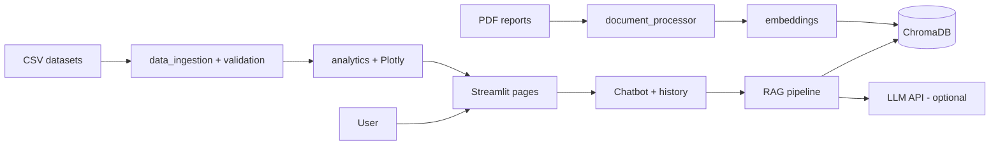

# AI Groundwater Information Assistant - Project Report

**Project ID:** P16 · **Team OJ16:** 1. Shashank Singh (12517817) · 2. Hemant Kaushik (12515559) · 3. Surender Kumar (12516464)

## 1. Abstract
Groundwater information in India is spread over long technical reports and large monitoring tables. This project builds a
web application that lets a user ask questions in plain language and receive answers taken from official Central Ground
Water Board (CGWB) documents, with the report name and page number. It uses Retrieval-Augmented Generation (RAG): PDF text
is split into chunks, converted to vectors, stored in ChromaDB, and the chunks closest to a question are given to a language
model that must answer only from them. A second part shows analytics (state/district trends, quarterly and yearly
comparisons) computed from real monitoring data loaded by the user from official portals. No data is generated or invented.

## 2. Introduction
Groundwater is a major source of drinking and irrigation water. Monitoring (water-level observations) and resource
assessment (recharge vs extraction) are published by government agencies, but finding a specific fact needs searching
hundreds of pages. Conversational AI plus retrieval can make this easier for students, farmers and researchers.

## 3. Problem statement
Users cannot quickly and reliably get groundwater facts from official sources. General chatbots answer from memory and may
invent numbers, which is unacceptable for water-related decisions.

## 4. Objectives
1. Answer groundwater questions with citations (report, page).
2. Refuse to guess when evidence is missing.
3. Index user-supplied government PDFs and keep page numbers.
4. Validate and visualise real groundwater-level records with full metadata.
5. Provide a simple, demonstrable, modular codebase with tests.

## 5. Existing system
Government portals (CGWB publications, India-WRIS) offer reports and data downloads, searchable by title or region but not by
question; reading reports requires manual effort. General-purpose chatbots are not tied to these documents.

## 6. Proposed system
A Streamlit application with: chatbot (RAG), document library, report search, analytics dashboard and a data-source
registry. Answers are source-grounded; dashboards show only validated data with source/period panels.

## 7. Literature and source review
- CGWB publishes the *National Compilation on Dynamic Ground Water Resources of India*; the 2024 edition (Faridabad, Dec 2024)
  states that assessment uses the Ground Water Estimation Methodology 2015 (GEC-2015) through the IN-GRES software with
  States/UTs. (Read from the report's front matter via search; confirm in your downloaded copy.)
- India-WRIS (indiawris.gov.in) provides groundwater-level data from CGWB and State departments; copies appear on the India
  Data Portal with station-level records and quarterly/other frequencies (dataset pages list update dates; check them).
- RAG (Lewis et al., 2020, "Retrieval-Augmented Generation for Knowledge-Intensive NLP Tasks") combines retrieval with generation.
- Sentence-BERT (Reimers & Gurevych, 2019) produces sentence embeddings used for similarity search.
Add the exact reports you use to the reference list below.

## 8. RAG methodology
1. **Extract** text per page (PyMuPDF). 2. **Clean** (join hyphenated words, collapse spaces). 3. **Chunk**: 1000 characters,
150 overlap (keeps sentences intact across boundaries; small enough for precise retrieval). 4. **Embed** with
all-MiniLM-L6-v2 (offline hashing fallback). 5. **Store** in ChromaDB (cosine distance, persisted). 6. **Retrieve** top 5 chunks;
chunks with similarity below 0.15 are discarded. 7. **Generate**: system prompt forces "answer only from context, cite [n]".
8. **Cite**: citations are built from the retrieved chunks' metadata, so a cited page always exists.
9. **Follow-ups**: the question is rewritten to be self-contained (LLM rewrite, or previous-question rule without LLM).
10. **Insufficient evidence** → fixed honest message; **no LLM** → retrieval-only mode, labelled as such.

## 9. System architecture

## 10. Data flow (chat)
Question → condense with history → embed → ChromaDB top-k → relevance filter → (LLM with context | passages) → answer +
citations → stored in session history → shown / downloadable.

## 11. Technology stack
Python (readable, rich libraries) · Streamlit (fast UI) · PyMuPDF (page-accurate text) · LangChain text splitter (robust
chunking) · Sentence Transformers/Hugging Face (embeddings) · ChromaDB (local vector DB) · Pandas/NumPy (data) · Plotly
(interactive charts) · any OpenAI-compatible LLM API (paid or free tier; optional).

## 12. Modules
| Module | Job |
|---|---|
| document_processor | PDF → page-tagged chunks |
| embeddings | text → vectors (+ offline fallback) |
| vector_store | ChromaDB storage, similarity + keyword search |
| rag_pipeline | ingestion, retrieval, answering, registry |
| chatbot | conversation history, export |
| source_citations | citations and LLM context |
| data_ingestion / data_validation | load, normalise, validate, register datasets |
| groundwater_analytics | summaries, trends, comparisons, charts |

## 13. Implementation notes
Embedding collections are named by model, so vectors from different models are never mixed. Re-uploading a PDF replaces its
chunks; identical content under another name is rejected as duplicate. Trend slopes need ≥ 3 years. Charts reverse the depth
axis so "down" means deeper.

## 14. Testing
42 automated pytest tests cover dataset loading/validation, duplicates, missing values, dates and units, PDF extraction, page
numbers, chunking, embeddings, vector retrieval and persistence, RAG answers, citation accuracy, honest no-evidence replies,
LLM success/failure paths (mocked), dashboard calculations (hand-checked values) and follow-up questions. Results: see TEST_RESULTS.md.
Tests use tiny fixtures created in temporary folders; they are not app data.

## 15. Limitations
- No real data bundled; network access to official sites was unavailable when the project was built, so real-data behaviour
  (large CSVs, real report layouts) has not been verified by the author of this scaffold - test with your downloads.
- Sentence-Transformers model was not testable in the build workspace (download blocked); tests ran on the offline fallback.
- Tables inside PDFs are extracted as plain text; numbers in tables may lose structure.
- Scanned PDFs need OCR (not included).
- LLM answers can still contain mistakes; always check cited pages.
- Dashboard shows historical observations; no forecasting is provided.

## 16. Future scope
OCR for scanned reports; table extraction; Hindi/Punjabi questions; geographic map by district boundaries; quality-report
(water chemistry) analytics; reranking models; evaluation set of Q&A pairs.

## 17. Conclusion
The project delivers a modular, honest, citation-first groundwater assistant. Its design prevents invented data: every number
shown comes from a user-loaded official file, and every answer comes from a retrieved report page.

## 18. References
1. Central Ground Water Board - https://cgwb.gov.in/ and Publications https://cgwb.gov.in/cgwbpnm/
2. CGWB, *National Compilation on Dynamic Ground Water Resources of India, 2024*, Faridabad, Dec 2024.
3. India-WRIS - https://indiawris.gov.in/ · National Water Data Portal - https://nwdp.nwic.gov.in/
4. Lewis, P. et al. (2020). Retrieval-Augmented Generation for Knowledge-Intensive NLP Tasks. NeurIPS.
5. Reimers, N., Gurevych, I. (2019). Sentence-BERT. EMNLP.
6. Streamlit, ChromaDB, LangChain, PyMuPDF, Plotly documentation.
